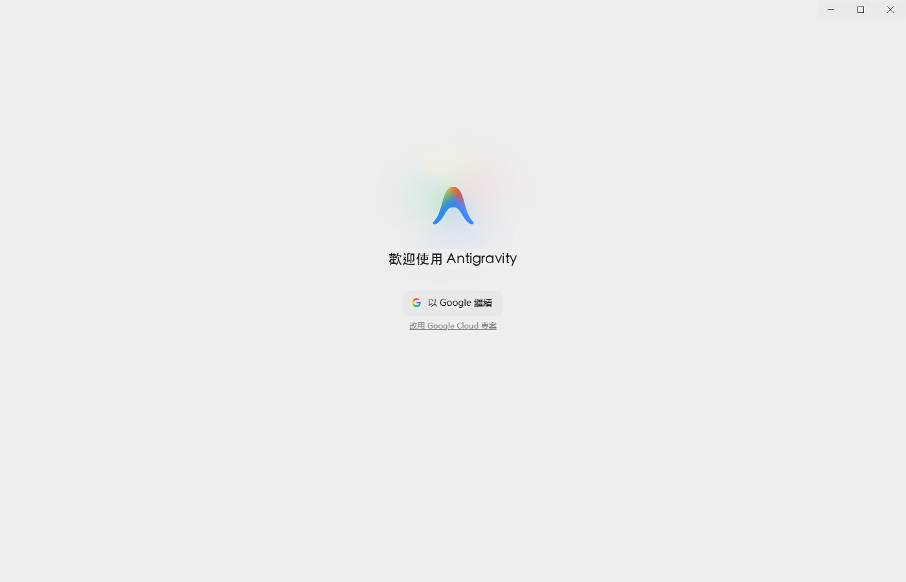

# Antigravity 台灣繁體中文在地化套件（antigravity2-TW）

> 本專案為 Google Antigravity 的繁體中文（台灣，zh-TW）在地化套件。  
> 底層注入架構源自 [qqxpee/antigravity2-cn](https://github.com/qqxpee/antigravity2-cn)，本分支專注於台灣軟體體例校訂、快取清理與跨版本自動自癒守護。

[](#-極速安裝指引)
[-brightgreen.svg)](#-術語對照標準)
[](https://github.com/qqxpee/antigravity2-cn)

👉 **[上游簡體中文專案 (Upstream Project)](https://github.com/qqxpee/antigravity2-cn)**

目前套件版本：**3.7.0**。適配 Antigravity **v2.33.0**；台灣用語與背景守護由本分支持續維護。

---

## 📌 術語對照標準

詞庫依據 macOS 與 Visual Studio Code 繁體中文（台灣）介面體例校訂，主要調整對照如下：

| 原版簡中轉譯 | 台灣開發者標準繁體 | 規範說明 |
| :--- | :--- | :--- |
| **命令面板** | **命令選擇區** | 對齊 VS Code 繁體中文介面標準（Command Palette） |
| **代碼倉庫 / Git 倉庫** | **儲存庫 / Git 儲存庫** | 對齊版本控制系統標準體例（Repository） |
| **智能體** | **代理** | AI 領域標準專用名詞（Agent） |
| **未配置計劃任務** | **未設定排程任務** | 修正排程與設定語意搭配（Scheduled Tasks） |
| **終端命令** | **終端機指令** | 對齊 macOS 終端機標準用法（Terminal Commands） |
| **本地** | **本機** | Local 對應本機規範 |
| **配置 / 配置文件** | **設定 / 設定檔** | Configuration / Config File 台灣標準體例 |
| **插件** | **外掛程式** | Plugin 標準中文用法 |
| **快捷鍵** | **快速鍵** | Shortcut 標準台灣體例 |
| **保存** | **儲存** | Save 標準台灣體例 |
| **重啓** | **重新啟動** | Restart 繁體標準用法 |
| **訪問策略** | **存取原則** | Access Policy 資訊安全標準體例 |
| **Token 預算超限** | **Token 預算額度已超限** | 語意精準完整 |
| **可復用** | **可重複使用** | 自然中文語序 |
| **暫無會話** | **尚無對話記錄** | 語意明確 |
| **確定** | **好** | 對齊 macOS 對話框確認按鈕體例 |
| **反重力智慧引擎** | **Antigravity** | 保留官方英文品牌標記，避免破壞辨識度 |

---

## ⚙️ 核心機制

1. **同步備份檔案**：偵測官方發布新版本時，自動將全新英文包同步備份為 `app.asar.bak`，避免還原時退回舊版。
2. **更新套用方式**：背景守護先在隔離目錄重建，確認官方檔案未再更新才置換，不主動強制關閉應用程式；手動安裝與背景守護皆會在套用後清理 Electron 瀏覽器／位元組碼快取（`Cache`、`Code Cache`、`GPUCache` 等）以避免新舊版本衝突，不會清除對話紀錄或個人設定。已開啟的視窗須重新啟動後載入。
3. **macOS 簽署驗證**：背景置換後執行本機 ad-hoc 簽署與驗證，失敗時嘗試還原並回傳錯誤。這不等同官方簽章或 Apple 公證。
4. **專注桌面體驗**：全面聚焦 Antigravity 2.0 獨立桌面版 IDE 的完整繁體中文化；停止支援 VS Code 擴充套件以確保運作穩定。
5. **常駐背景守護**：提供 macOS `launchd` 原生守護服務與 Windows 排程工作，官方版本更動時自動於背景重編注入。
6. **遠端版本自動檢測**：背景守護服務每 24 小時定期查詢 GitHub 最新發布版本並記錄於日誌；macOS 同時透過原生通知提醒升級且不彈出終端機視窗。Windows 工作排程依系統預設每 5 分鐘喚起背景程式時，命令列視窗可能短暫閃現。

---

## 📸 介面效果展示

### 1. 歡迎頁與登入新手導引


### 2. 主編輯器介面與選單


### 3. 詳細參數設定面板


---

## 🚀 極速安裝指南（獨立桌面版 IDE）

本套件僅需電腦安裝 **Node.js 22.12.0 以上**（[點此下載官方安裝包](https://nodejs.org/)，安裝時一路點「下一步」即可；執行期零外部依賴，無須額外執行 `npm ci`）。

### 方法一（首選）：交給 AI 工具協助檢查並安裝（推薦・免記指令）

本套件已內建 AI 安裝引導手冊（[`AI_INSTALL_GUIDE.md`](AI_INSTALL_GUIDE.md)）。交給 AI 後，它會**先唯讀檢查環境與程式安全，再列出 `1～4` 選項（安裝繁中＋守護／僅裝繁中／只看不改／還原英文）讓你決定**，不用一次記憶複雜參數。

不論使用 **Antigravity 對話框**、**Claude Code、Codex、Cursor 或 Gemini CLI**，只要複製下面其中一句貼上即可：

- **還沒下載專案？貼上這句給 AI：**
  ```text
  請幫我把 https://github.com/atonnyshen/antigravity2-TW 下載（或更新）到我的「下載」資料夾，並讀取裡面的 AI_INSTALL_GUIDE.md，先檢查環境與安全性再讓我選擇要執行的項目。
  ```

- **已經打開下載好的資料夾？貼上這句就好：**
  ```text
  請依照 AI_INSTALL_GUIDE.md 先幫我檢查環境與安全性，再讓我選擇要執行的項目。
  ```

---

### 方法二：自己手動點兩下安裝（圖形介面操作）

1. **下載與解壓縮**：
   - 點擊本頁右上角綠色按鈕 **`Code`** → 選擇 **`Download ZIP`**（或前往右側 **Releases** 下載最新發布壓縮檔）。
   - 將壓縮檔**完整解壓縮**到電腦一般資料夾（Windows 使用者請勿直接在 ZIP 預覽視窗內點兩下檔案）。
2. **完全關閉** Antigravity 應用程式。
3. 進入解壓縮後的資料夾，點兩下對應系統的安裝檔：
   - **macOS 使用者**：點兩下執行 **`點兩下安裝繁體中文.command`**。
   - **Windows 使用者**：點兩下執行 **`點兩下安裝繁體中文.bat`**（若 Antigravity 安裝在 `C:\Program Files\Antigravity`，請對檔案按右鍵選擇「**以系統管理員身分執行**」）。
4. 畫面出現品牌文字選擇時，直接按 Enter（預設保留官方英文 `Antigravity`）。
5. 重新啟動 Antigravity，即可進入繁體中文（台灣）介面。

> **進階使用者／Git 命令列**：
> ```bash
> git clone https://github.com/atonnyshen/antigravity2-TW.git && cd antigravity2-TW
> node localization_engine.js --tw --interactive
> ```

---

## 📊 版本與架構支援說明

Google Antigravity 發展歷程中包含不同產品形態，本專案的支援範疇與邊界說明如下：

| 版本／形態 | 架構類型 | 應用程式路徑／識別名稱 | 繁體中文支援狀態 | 說明與建議 |
| :--- | :--- | :--- | :---: | :--- |
| **Antigravity 2.0 桌面端** | 獨立 Electron 客戶端 | `/Applications/Antigravity.app`<br>`Programs\Antigravity` | **主要支援** | 依字典翻譯介面並提供背景守護；官方新增介面可能仍有漏譯。2.17.0 已做本機隔離重建測試。 |
| **Antigravity 1.0 桌面端** | 舊版 VS Code Fork 客製 IDE | `/Applications/Antigravity IDE.app`<br>`Programs\Antigravity` | **基礎相容（建議升級）** | 早期 HTML 腳本注入架構。本專案保留相容偵測邏輯，但因 Google 官方已停止維護 1.0 且全線轉移至 2.0，強烈建議使用者升級至 2.0 取得完整繁中體驗。 |
| **VS Code 官方外掛** | VS Code 擴充套件（`google.google-antigravity`） | `~/.vscode/extensions/google.google-antigravity-*` | **已停止支援** | 核心設定與對話側邊欄由本地閉源二進位檔（`agy`）動態透過 iframe 輸出，無法全介面繁中化，且背景連線易受干擾。專案已全面終止支援。 |

---

## 💻 關於擴充套件（Extensions / Plugins）與 VS Code 舊外掛說明

許多使用者詢問「擴充套件是否支援中文化？」以及「為什麼在新版中找不到 VS Code 外掛修改腳本？」，說明如下：

1. **Antigravity 2.0 獨立桌面端外掛介面已全量繁中化**：
   - 在 Antigravity 2.0 獨立桌面軟體中，內建的**擴充功能清單、外掛程式市集（Plugins / Marketplace）、伴生側邊欄（Sidecar）以及 MCP 工具管理介面**，本套件均已 100% 深度繁中化，使用者安裝本套件後即可直接享受完整中文外掛體驗，不需要也不存在單獨的外掛補丁。
2. **早期外部 VS Code 擴充外掛腳本已正式下線退役**：
   - 早期專案曾針對「微軟一般 VS Code 裡安裝的 Antigravity 擴充套件」提供實驗性補丁腳本（`localize_vscode_extension.js`）。
   - 由於 Google 官方已全面將開發重心轉移至 Antigravity 2.0 獨立桌面版，所有新一代功能（如多代理平行協作、終端機沙箱、SSH 遠端連線等）皆僅在獨立桌面版中提供；一般 VS Code 擴充版功能已與獨立版分道揚鑣，且微軟擴充功能市集之保護機制容易引發背景連線異常。
   - 為維持套件精簡與極致穩定度，自 **v3.4.0** 起，上游與本專案已全面移除舊版 `localize_vscode_extension.js` 及其配套還原腳本，全力聚焦深耕獨立桌面端。

---

## 🛡️ 背景自動更新守護（有更新自動重套，支援 macOS / Windows）

Antigravity 官方更新會覆蓋資源檔。守護程式偵測變更後重套繁中，結果寫入日誌。已處理的檔案會記錄雜湊；引擎或字典修訂後也會重新套用。

### 🍎 macOS 使用者

支援 nodejs.org 官方安裝包（`/usr/local/bin/node`）、Homebrew（`/opt/homebrew/bin/node`）或系統 `PATH` 中的 Node.js 22.12+，並依應用程式目錄權限自動選擇系統級 `LaunchDaemon`（`/Library/Application Support/Antigravity2TW/runtime.*`）或使用者級 `LaunchAgent`（`~/Library/Application Support/Antigravity2TW/runtime`），不會讓背景服務直接執行下載資料夾中可任意改寫的腳本。

觸發時機包含系統啟動、應用程式檔案變動與每 **5 分鐘**巡檢一次；更新本專案後重新執行安裝器即可更新背景副本。若日誌出現 `EPERM` 或 `Operation not permitted`，請檢查「系統設定 → 隱私權與安全性 → App 管理」授權。

- **啟用背景自動守護**（點兩下或一行指令安裝）：
  *(若已下載本專案，直接點兩下執行 **`點兩下安裝macOS背景守護.command`** 即可)*
  ```bash
  curl -fsSL https://raw.githubusercontent.com/atonnyshen/antigravity2-TW/main/install_macos_autowatcher.sh | bash
  ```
- **卸載背景守護**（停止服務，保留設定與日誌供檢查）：
  *(若已下載本專案，直接點兩下執行 **`點兩下卸載macOS背景守護.command`**)*
  ```bash
  bash uninstall_macos_autowatcher.sh
  ```

在本專案目錄執行卸載指令（系統級 `LaunchDaemon` 則加上 `sudo`）。檢查服務與最近結果（系統級／使用者級）：

```bash
launchctl print system/com.antigravity.autolocalize
tail -n 60 /Library/Logs/Antigravity2TW/autolocalize.log
# 若安裝為使用者級 LaunchAgent：
tail -n 60 ~/Library/Logs/Antigravity2TW/autolocalize.log
```

確認 `last exit code = 0`，並看到「繁中套件已套用並驗證」或「已是目前版本」日誌即代表正常。背景服務每次執行完就會結束，`state = not running` 不代表未註冊。還原官方英文前先停用守護，避免它自動重套。

---

### 🪟 Windows 使用者

工作排程支援系統中的 Node.js 22.12+（自動搜尋標準安裝路徑與 `PATH`），每 **5 分鐘**自動巡檢一次，並將紀錄寫入專案資料夾內的 `autolocalize.log`。所有 Windows `.bat` 檔皆採純 ASCII 與 `CRLF` 編碼，執行期零外部依賴，可直接雙擊啟動。

觸發時機為每 **5 分鐘**定時檢查；只有當 Antigravity 官方主程式更新或本套件字典更新時才會重建套用，其餘時間立即略過。若 Antigravity 安裝於受保護的 `C:\Program Files\Antigravity`，安裝或卸載守護時請對批次檔按右鍵選擇「**以系統管理員身分執行**」。

- **啟用背景自動守護**（點兩下或指令註冊排程）：
  *(若已下載本專案，直接點兩下執行 **`點兩下安裝Windows背景守護.bat`** 即可)*
  ```powershell
  node auto_localize_watcher.js --install-windows-task
  ```
- **卸載背景守護**（移除排程工作，停止自動檢查）：
  *(若已下載本專案，直接點兩下執行 **`點兩下卸載Windows背景守護.bat`**)*
  ```powershell
  node auto_localize_watcher.js --uninstall-windows-task
  ```

亦可在專案資料夾內以 PowerShell 執行 `.\install_windows_autowatcher.ps1` 或 `.\uninstall_windows_autowatcher.ps1`。檢查排程狀態與最近執行紀錄：

```powershell
schtasks /query /tn AntigravityAutoLocalize
Get-Content .\autolocalize.log -Tail 40 -Encoding UTF8
```

確認狀態為已就緒，並看到「繁中套件已套用並驗證」或「已是目前版本」日誌即代表正常。還原官方英文前先卸載守護，避免 5 分鐘內自動重套。

---

## 🔄 一鍵還原官方英文

若需隨時還原至官方原版英文狀態：

### 1. 桌面版 IDE 還原：
- **macOS 使用者**：點兩下執行 **`點兩下還原官方英文.command`**。
- **Windows 使用者**：點兩下執行 **`點兩下還原官方英文.bat`**（若安裝於 `Program Files`，請以系統管理員身分執行）。

### 2. 背景自動守護卸載：
- **macOS 使用者**：點兩下執行 **`點兩下卸載macOS背景守護.command`**（或執行上方終端機卸載指令）。
- **Windows 使用者**：點兩下執行 **`點兩下卸載Windows背景守護.bat`**。

備份檔完好保存，執行還原腳本即可迅速恢復官方原版英文狀態（還原前建議先卸載背景守護，避免 5 分鐘內自動重新繁中化）。

---

## 🤝 致謝與開源聲明

開發者驗證：執行 `npm ci --ignore-scripts` 與 `npm test`。GitHub Actions 在 macOS、Windows 與 Linux 跑回歸測試；測試不代表已驗證真實 Windows 排程或每個官方版本的介面。

- 特別感謝 [qqxpee/antigravity2-cn](https://github.com/qqxpee/antigravity2-cn) 原作者的開源貢獻與 ASAR 注入架構設計。
- 本存放庫為個人使用與分享版本，主要維護繁體中文語境字典與自動更新腳本。
- 若使用時發現漏譯或語意不順的詞條，歡迎隨時提交 Issue 或 PR 共同補充！
